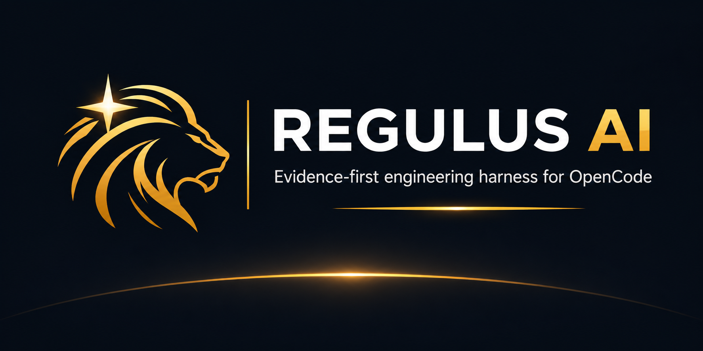
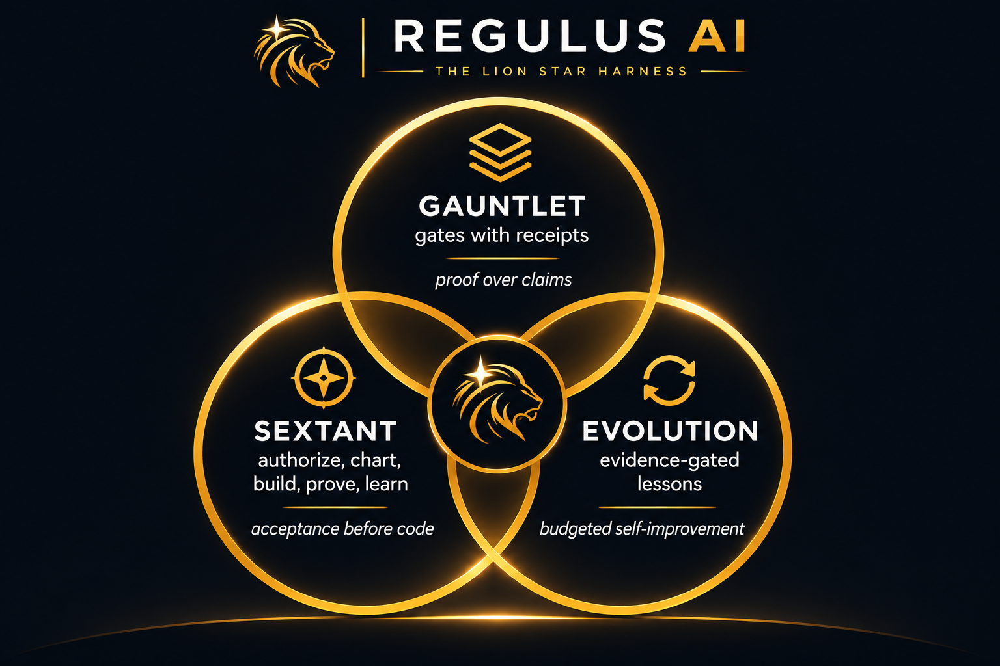
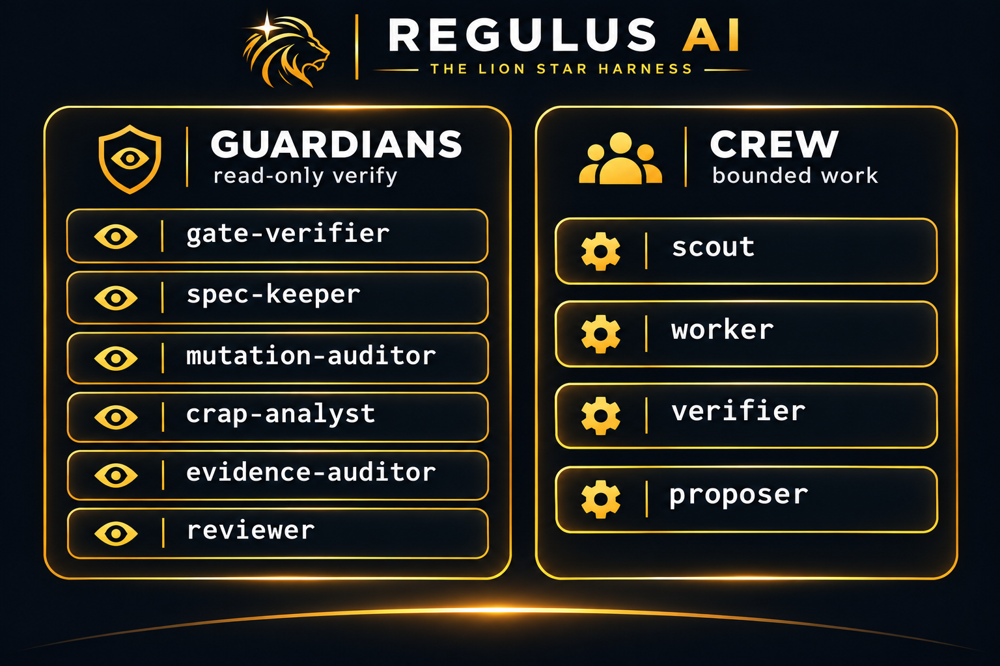
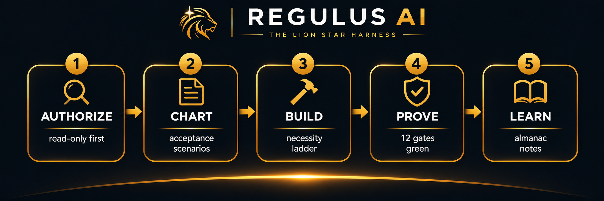
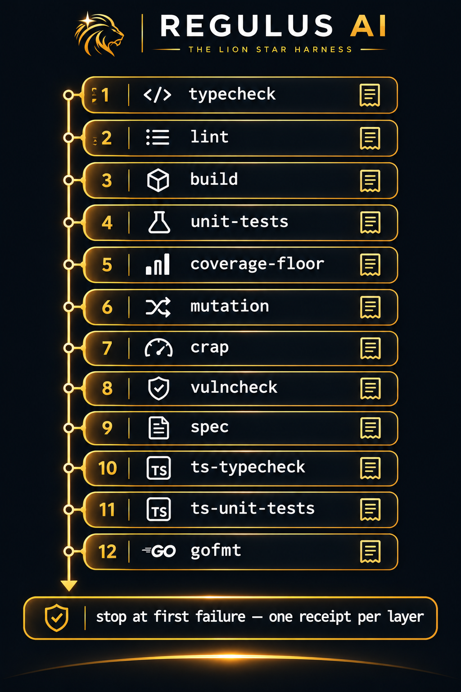
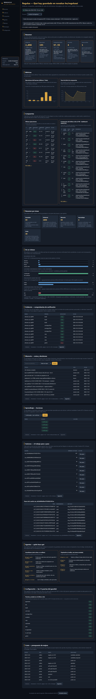

# Regulus AI



**An OpenCode-native, self-improving engineering harness: a guardian gauntlet over the code, the Sextant workflow over the work, and evidence-driven evolution of the harness itself.**

> Status: v0.13.0 — Gauntlet · Discipline · self-improving Evolution, now with speed-tokens (context 1 spawn, compaction concurrente, staleness cache, reindex diferido, gate --quick, toolset cache, record-batch, minimal recortado, bench budget gate), fresh-fixes (CI en develop, MCP 14→17, gate --quick en tools, serve espacio/timeouts, status acotado, HTTP 500s honestos, did-you-mean), regulus-100 al 100, CRAP paydown bajo 30 y bench gate exit — proven by the suite (Go + bun) on this very repository.

Regulus AI fuses four proven ideas into one harness for [OpenCode](https://opencode.ai) V2:

- **Runtime discipline** (workflow adapted from open practice, [Gentle-AI](https://github.com/Gentleman-Programming/gentle-ai) credited): the Sextant — five movements, every one ending in evidence; task sizing, Charts (feature documents) with verbatim specs, delegation by reason, receipts for every claim.
- **Recursive harnessing** (inspired by [Harness²](https://github.com/google-research/harness2), Google Research): the harness treats its own components (prompts, guardrails, memory, skills, agents) as an editable surface and improves them from execution evidence, under an explicit budget.
- **The right not to read the code** (Uncle Bob's gauntlet): the human approves acceptance criteria and audits evidence receipts — never line-by-line diffs. Read-only guardian agents verify that the code meets the spec contract through layered deterministic gates (typecheck → lint → build → tests → mutation testing → CRAP analysis).
- **The Necessity Ladder** (craft doctrine adapted from [Ponytail](https://github.com/DietrichGebert/ponytail), MIT): solve the whole problem with the least new code — reuse first, and never cut validation, security or accessibility; a sixth guardian, the reviewer, reads the code the change touches, not just the diff.



## Quickstart

**Prerequisites**: [OpenCode V2](https://opencode.ai) (the only supported runtime — the doctor refuses V1), Node.js 18+ and Go (the core build).

```bash
# 1. Build the core from source (no npm distribution yet — `regulus-ai`
#    is not published; the quickstart is build-from-repo)
git clone https://github.com/NOVALUX-HN/RegulusAI && cd RegulusAI
npm run build          # = bash scripts/build.bash → binaries/regulus-<os>-<arch> + stamped local bin/regulus
# then put the binary for your platform on your PATH as `regulus`

# 2. Verify the runtime — this is the only install check you need
regulus doctor      # opencode v2.x — supported (V2)

# 3. In your project: declare the gauntlet (regulus.json)
cat > regulus.json <<'EOF'
{
  "gates": [
    { "name": "typecheck", "layer": 1, "command": "go build ./..." },
    { "name": "lint", "layer": 2, "command": "go vet ./..." },
    { "name": "build", "layer": 3, "command": "go build -o bin/app ./cmd/app" },
    { "name": "unit-tests", "layer": 4, "command": "go test ./..." },
    { "name": "coverage-floor", "layer": 5, "command": "go test ./... -coverprofile=.regulus/coverage.out >/dev/null && go tool cover -func=.regulus/coverage.out | tail -n1", "metric": { "extract": "last-line-percent", "threshold": 80, "operator": ">=" } },
    { "name": "crap", "layer": 7, "command": "regulus crap --profile .regulus/coverage.out --max 30" }
  ],
  "evolution": { "max_per_day": 10 }
}
EOF

# 4. One look at the project
regulus status
```

Then open `opencode` in the project: the plugin registers the regulus tools, the guardians (`@regulus-gate-verifier`, `@regulus-spec-keeper`, `@regulus-mutation-auditor`, `@regulus-crap-analyst`, `@regulus-evidence-auditor`, `@regulus-reviewer`) and the Crew (`@regulus-scout`, `@regulus-worker`, `@regulus-verifier`), and the `regulus-workflow` skill runs the Sextant.



## The Sextant — five movements

| Movement | What it means | The evidence it leaves |
|---|---|---|
| **AUTHORIZE** | read-only investigation; one focused question if intent is unclear | — |
| **CHART** | acceptance scenarios (Given/When/Then) in `charts/<feature>.md` before implementation | `spec check` exit 0 |
| **BUILD** | the Necessity Ladder; never cut validation, security, accessibility | gauntlet receipts per step |
| **PROVE** | all gates green, receipts cited (`rec_…`) | `gate run` receipts |
| **LEARN** | notes to the Almanac; the lesson admitted through the guardian | ledger + INDEX |



## Commands

| Command | What it does |
|---|---|
| `regulus doctor` | probe OpenCode and verify V2 (refuses V1 with guidance) |
| `regulus status` | one look: runtime, gauntlet, evolution vs cap, lessons, receipts |
| `regulus contract` | the plugin↔core contract version |
| `regulus spec check <file>` | validate the acceptance contract of a Chart |
| `regulus gate run <task>` | the layered gauntlet: stop at first failure, one receipt per layer |
| `regulus evidence list [--task <t>] \| verify [--task <t>] \| prune --task <t> [--keep N] [--yes] [--force]` | receipts: one line each, full sha256-pinned output, verified proofs, retention-gc |
| `regulus crap --profile <p> [--max 30]` | CRAP scores: complexity × (1 − coverage)³ + complexity |
| `regulus audit --profile <p> [--top 10] [--max N]` | Repo-wide ranked audit: entry points first, then must-fix / should-fix / nice with the top item named |
| `regulus memory note <text>` | a durable session note (survives restarts and compaction) |
| `regulus memory save --type <t> --title <t> …` | a typed observation with provenance (decision, discovery, preference) |
| `regulus memory search [terms]` | deterministic bucket-then-match, age annotations |
| `regulus memory history --topic-key <k>` | the revision chain of an evolving topic |
| `regulus memory context [--limit N] [--task T] [--path P] [--system S] [--budget N]` | the deterministic resume block (bounded by default: latest 20 notes, 20 items per long list; `--limit 0 --budget 0` = full store): project identity, charts, notes, lessons with content, decisions/discoveries/preferences |
| `regulus init [--stack go\|node\|smoke] [--devin]` | onboard a fresh repo: regulus.json, charts/, .gitignore, optional `.devin/mcp_config.json` |
| `regulus mcp` | stdio MCP server for Devin CLI/Desktop/Cloud (14 tools, MCP trust boundary in docs/devin.md) |
| `regulus yolo [on\|off\|status]` | safe YOLO toggle: flips only the bash/edit catch-alls, destructive denies always stay |
| `regulus surface propose/list/apply` | harness-surface edits: guardian allowlist, per-extension markers, never creates files |
| `regulus probe contrast/compose` | behavioral contrast evidence under the evolution budget (daily + per-task caps) |
| `regulus trace show/sessions/files` | session tool-execution fingerprints and touched paths |
| `regulus reflect --domain --task --cue --lesson <doc>` | propose an evidence-gated lesson candidate (nothing admitted without a guardian) |
| `regulus library candidates` | pending candidates |


| `regulus library admit --domain --candidate --guardian` | complete the admission: INDEX + Almanac + ledger |
| `regulus library list / show` | admitted lessons / the domain INDEX, verbatim |
| `regulus budget show` | the evolution ledger, oldest first |
| `regulus budget record --kind probe` | record an opt-in probe run (budget-gated, k=1) |

## Dashboard



Panel read-only del harness: sidebar, KPIs, gráficos y tablas con datos reales del backend, sin editar nada.
Ábrelo con `regulus serve --port=17817` y visita http://localhost:17817/ (también vale `/dashboard`).
La imagen de arriba es captura real del panel nuevo (tema Obsidian & Gold que replica el mockup), no el mockup.

## Documentation

| Document | Contents |
|---|---|
| [PRD](docs/PRD.md) | Problem, product definition, requirements per loop, phased roadmap (F1–F5), risks |
| [Architecture](docs/architecture.md) | Go core + TS plugin boundary, state model, receipts, gates, evolution flow |
| [Memory design](docs/memory.md) | The Almanac: seven improvements over the prior art, storage, CLI surface |
| [Chart — v1](charts/regulus-ai-v1.md) | Verbatim specs, task list, ship's log of the whole build |
| [Chart — F5](charts/f5-release.md) | The release phase's own acceptance scenarios |
| [Devin](docs/devin.md) | Windows blueprint, CLI/Desktop/Cloud recipe, MCP trust boundary, deliberate tool gaps |
| [Troubleshooting](docs/troubleshooting.md) | YOLO reload, console flashing, whitelist/reserved refusals, cap refusals |
| [Agents](docs/agents.md) | Crew and guardian roles, permissions, delegation rules |

## Name

*Regulus* — α Leonis, the brightest star of Leo, "the heart of the lion"; Latin for "little king".

## License

MIT
