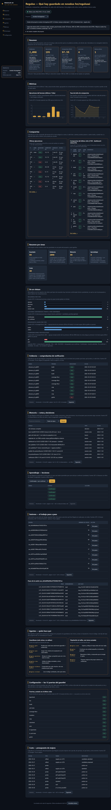

# Dashboard — harness vivo siempre encendido

Página local read-only en puerto fijo para ver lo importante del harness,
lo guardado y cómo aprende el Almanac. Abrirla y entenderla no requiere
leer código: cada sección dice qué significa en lenguaje simple.
Desde V1/V4 el panel replica el mockup `docs/assets/dashboard-vision.png`
(tema Obsidian & Gold): sidebar con 7 secciones, pill del último ciclo,
5 KPIs, 2 gráficos y 2 tablas con datos reales del backend.



Captura real del panel nuevo a 1280px (página completa). En móvil la
sidebar colapsa arriba: ver `assets/dashboard-v4-mobile.png`.

## Abrir el panel

```bash
regulus serve --port=17817        # default 127.0.0.1:17817
# abrir http://localhost:17817/ (también vale /dashboard)
```

- Solo GET + loopback por defecto (`--bind` para cambiar, bajo tu riesgo:
  si bindeas fuera de loopback el servidor avisa por stderr que los datos
  del proyecto quedan expuestos a esa red).
- Errores con el mismo envelope que MCP (`regulus.http/v1` pineado).
- Auto-refresh cada 30s, sin dependencias (cero JS externo; la UI viene
  embebida en el binario).

## Arranque automático (las 3 plataformas)

Windows (PowerShell):

```powershell
powershell -NoProfile -File scripts/install-dashboard-autostart.ps1
# quita con -Uninstall
```

Crea `shell:startup\Regulus Dashboard.lnk` → `bin\regulus serve --port=17817`.
Tras reiniciar, abre `http://localhost:17817/`. Para probar sin reiniciar,
doble clic al acceso directo o corre `regulus serve` a mano.

Linux (systemd user, con fallback a cron):

```bash
bash scripts/install-dashboard-autostart.bash
# quita con --uninstall
```

Escribe `~/.config/systemd/system/regulus-dashboard.service`
(`ExecStart=<repo>/bin/regulus serve --port=17817 --bind=127.0.0.1`,
idempotente: re-ejecutar actualiza) e intenta `systemctl --user enable
--now`. Sin systemd imprime una línea `@reboot ...` para `crontab -e`.

macOS (LaunchAgent):

```bash
bash scripts/install-dashboard-autostart.bash
# quita con --uninstall
```

Escribe `~/Library/LaunchAgents/ai.regulus.dashboard.plist`
(`RunAtLoad`, binario + `serve --port=17817 --bind=127.0.0.1` del repo) e
intenta `launchctl load -w`. Sin `launchctl` imprime el comando manual.

Opciones del script POSIX: `--port=N`, `--repo=DIR`, `--bind=ADDR`,
`--uninstall`. Verificado: escribe la unit en Linux, el plist en macOS
(XML válido), avisa con el comando manual cuando no hay gestor de
servicios, e instalar/desinstalar dos veces seguidas deja un solo fichero
o ninguno. En cualquier plataforma el plan B siempre funciona:

```bash
regulus serve --port=17817
```

## Guía por sección (qué muestra cada parte)

### Vista visión (réplica del mockup, arriba del todo)

Sidebar — navegación lateral con 7 entradas con icono:
Resumen, Evidencia, Compuertas, Agentes, Métricas, Almanaque y
Configuración (Agentes y Configuración saltan a sus secciones reales más
abajo). Debajo, tarjeta «Proyecto» con nombre real (`GET /v1/status`
campo `project`), rama actual (`GET /v1/git`, `—` fuera de git) y última
ejecución en relativo («Hace 5 min», `sin actividad` sin ciclos). En
móvil (360px) la sidebar colapsa arriba en fila horizontal con scroll
propio, sin scroll horizontal de página.

Pill del último ciclo — en la cabecera, junto al título: `Último ciclo:
PASS #N · fecha` (borde verde) o `FAIL #N` (borde rojo), `sin datos` sin
ciclos. Fuente: el ciclo con `#` mayor de `GET /v1/executions`
(1 = más antiguo); la fecha sale de su campo `date`.

5 KPIs — las cinco cifras del mockup, cada una con qué significa en
lenguaje simple y su fuente exacta (el número es global, el delta compara
últimos 7 días contra los 7 previos):

- Evidencias: comprobantes guardados. Fuente `GET /v1/metrics` campo
  `receipts_total` (formato `1,248`); delta % 7 días desde `started_at`
  de los receipts (`nuevo en 7 días` si antes era 0, `sin cambios` si
  ambos son 0).
- Ejecuciones: ciclos numerados del harness (#1 el más antiguo). Fuente
  `GET /v1/executions` campo `total`; delta % 7 días desde `date`.
- Compuertas (PASS): de cada 100 pruebas, cuántas salieron bien. Fuente
  `GET /v1/metrics` campo `verification_pass_rate` (formato `98.8%`) más
  `receipts_pass/receipts_total`; delta en puntos (pp) 7 días desde los
  veredictos (`sin datos` sin receipts en ventana).
- Lecciones: cosas que Regulus ya aprendió. Fuente
  `GET /v1/almanac/summary` campo `lessons_admitted`; delta `N nuevas
  (7 días)` desde `CreatedAt`.
- Ramas activas: ramas vistas en los ciclos más la actual. Fuente
  `GET /v1/executions` campo `branch` + `GET /v1/git` (rama actual);
  muestra el conteo y hasta 5 nombres. Límite honesto: los ciclos sin
  manifest (o con manifest anterior a V3, sin rama) muestran `—` y no
  cuentan; si solo se ve este checkout avisa `solo se ve este checkout`.
- Deltas parciales: las ventanas de 7 días se calculan en cliente con
  tope de 1000 por colección (lo más nuevo); si algún total lo supera,
  aparece `Cifras de 7 días parciales (límite 1000 por colección): ….
  Los totales de las tarjetas son globales`.

2 gráficos (Métricas) — actividad diaria de los últimos 7 días y tasa de
éxito diaria, con ejes. Sin barras ni puntos cuando un día no tiene
datos (`Sin datos todavía: no hay comprobantes en los últimos 7 días`).
Fuentes: `GET /v1/receipts` paginado (tope 1000, agrupa `started_at` por
día) para barras; `pass/total` por día para la línea con banda. La línea
usa escala 90–100% cuando todo va alto.

2 tablas (Compuertas) — últimas ejecuciones y compuertas del último ciclo:

- Últimas ejecuciones: una fila por ciclo numerado (#N), las más nuevas
  primero (máx. 8). Columnas `#/Rama/Resultado/Compuertas/Duración/Fecha`.
  Fuente `GET /v1/executions` (rama del manifest, `—` sin manifest o sin
  rama; el título de la rama lleva la task). Vacío: `Sin ejecuciones
  todavía (GET /v1/executions, total 0)`.
- Compuertas del último ciclo: abre el último ciclo prueba por prueba.
  Columnas `#/Compuerta/Estado/Tiempo/Evidencia` (la evidencia es la ruta
  del receipt, truncada a 140 con `title` completo). Fuente: los receipts
  de la task del último ciclo (`GET /v1/receipts?task=`) agrupados igual
  que el backend (mismo `run_id`, o misma task + hora UTC sin `run_id`),
  ordenados por `started_at` (máx. 12 + fila `… N compuertas más`).
  `Sin compuertas` si el último ciclo no tiene comprobantes. La lista de
  Configuración (las 12 puertas fijas de `regulus.json`: typecheck, lint,
  build, unit-tests, coverage-floor, mutation, crap, vulncheck, spec,
  ts-typecheck, ts-unit-tests, gofmt) pinta al lado el estado vivo de ese
  ciclo (`PASS`/`FAIL`/`— en este ciclo`).

Agentes — quién hace qué: lista fija del repo (`docs/agents.md`), no
inventada por el panel. Guardianes (solo miran): gate-verifier,
spec-keeper, mutation-auditor, crap-analyst, evidence-auditor, reviewer.
Tripulación (sí edita): scout, worker, verifier, proposer.

### Secciones clásicas (debajo de la vista visión)

Cabecera — nombre real del proyecto + estado y salud. El `<h1 id="project-name">`
y el `<title>` se rellenan desde `GET /v1/status` campo `project`
(`almanac.ProjectName(".")`: remote `origin` normalizado a `owner/repo`
o minúsculas del dirname, `internal/almanac/export.go:14-54`; sin JS queda
el fallback genérico, con JS dice «Regulus — Qué hay guardado en
<project>», siempre por `textContent`). Lee además `GET /v1/status`
(salida de `regulus status`: bien si `exit` es 0) y `GET /v1/version`
(campo `version`), más `GET /v1/metrics` (objeto `metrics` con `tasks`,
`receipts_pass` / `receipts_total` de `evidence.List` y
`verification_pass_rate = pass/total`; mejoras usadas hoy
`evolution_used` de `budget.TodayEvolutionCount` frente a
`evolution_cap`). Con proyecto vacío: `tasks 0`, `0 de 0` sin porcentaje
(cero, nunca NaN: `observability/metrics.go` solo divide si hay datos).
El desplegable «Ver estado completo» muestra el stdout tal cual. Todo
texto libre llega ya redactado (D3).

Resumen por áreas — 5 tarjetas con número + explicación + fuente exacta
(cada tarjeta pide su endpoint con `?limit=1` pero pinta el campo
`total` global, no el único item):

- Guardado: todo lo conservado (`GET /v1/almanac/summary`, campo `total`, sin filtro).
- Evidencia: comprobantes de verificación (`GET /v1/receipts?limit=1`, campo `total`, sin `?task=`).
- Memoria: recuerdos anotados (`GET /v1/observations?limit=1`, campo `total`, sin `?q=`/`?type=`; la tabla sí filtra).
- Aprendizaje: lecciones confirmadas + por confirmar (`GET /v1/lessons?status=all&limit=1`, campo `total` = admitidas + candidatas).
- Coste: movimientos del presupuesto (`GET /v1/budget?limit=1`, campo `total`, sin `?task=`).

De un vistazo — 4 mini gráficos de barras CSS puros (sin JS externo):

- Recuerdos por tipo (`GET /v1/almanac/summary`, campo `by_type`; conteo global, sin límite).
- Lecciones confirmadas frente a por confirmar (campos `lessons_admitted` / `candidates_pending` del mismo summary, global).
- Presupuesto usado por tipo (agrupa `budget.items[].kind` de `GET /v1/budget?limit=200`: los primeros 200 de `total`, los más antiguos primero; si `total > 200` el gráfico es parcial y la etiqueta lo dice).
- Comprobaciones por resultado (agrupa `receipts[].receipt.verdict` de `GET /v1/receipts?limit=200`: los primeros 200 de `total`, los más antiguos primero; si `total > 200` el gráfico es parcial y la etiqueta lo dice).
- Proyecto vacío: cada grupo pinta «Sin datos todavía: proyecto vacío o filtro sin resultados» (barras a 0, nunca NaN: ancho `0%` cuando `max` es 0).

Evidencia — comprobantes de verificación. Cada fila es una vez que
Regulus comprobó que el trabajo estaba bien: tarea, prueba (`gate`),
resultado y fecha. Fuente: `GET /v1/receipts?limit=&offset=&task=`,
10 por página con Anterior/Siguiente. Vacío: fila «Sin comprobantes
todavía ... (GET /v1/receipts, total 0)» y «Mostrando 0–0 de 0».

Memoria — notas y decisiones. Lo que Regulus anotó para no olvidarlo.
Buscador de texto (`q` en título/contenido) + filtro por tipo. Fuente:
`GET /v1/observations?q=&type=&task=&limit=&offset=`, 10 por página.
Vacío/búsqueda sin resultados: fila «Sin recuerdos todavía ... (GET
/v1/observations, total 0)».

Aprendizaje — lecciones. Lo ya confirmado (`Confirmada`) y lo que cree
haber aprendido pero está por confirmar (`Por confirmar`). Filtro por
estado. Fuente: `GET /v1/lessons?status=admitted|candidate|all&limit=`,
10 por página, texto truncado a 140 caracteres en la tabla. La tarjeta
usa `status=all`; la tabla usa el filtro elegido (la etiqueta de vacío lo
nombra). Vacío: fila «Sin lecciones todavía ... (GET /v1/lessons, total
0)».

Sesiones — el trabajo paso a paso. Cada sesión es una racha de trabajo
seguida con su n.º de pasos; «Ver pasos» lista qué hizo Regulus en cada
paso, en orden (llamada, herramienta, resumen). Fuentes:
`GET /v1/traces?limit=&offset=` (sesiones) y
`GET /v1/traces?session=&limit=&offset=` (entradas), 10 por página.
Vacío: fila «Sin sesiones todavía ... (GET /v1/traces, total 0)», título
«Pasos de la sesión — sin sesión (proyecto vacío o sin trazas)» y fila
«Sin pasos ... (total 0)».

Coste — presupuesto de mejora. Cada fila es un movimiento del presupuesto
que Regulus usa para mejorar solo: fecha, tipo, tarea y resultado.
Fuente: `GET /v1/budget?task=&limit=&offset=`, 10 por página. Vacío:
fila «Sin movimientos todavía ... (GET /v1/budget, total 0)».

Leyenda, paginadores y textos largos — bajo «De un vistazo» hay una
leyenda con el significado de cada veredicto (PASS/FAIL/BLOCKED,
Confirmada/Por confirmar/Sin dato). Cada paginador muestra
«Mostrando lo–hi de total · página N de M · GET /v1/…» y, en las
tablas con filtro (Memoria, Aprendizaje, pasos de sesión), nombra el
filtro activo (`q`/`type`, `status`, `session`). Las celdas largas
truncadas a 140 caracteres muestran el texto completo al pasar el
cursor (`title`). Con proyecto vacío, bajo las tarjetas aparece
«Sin datos todavía: proyecto vacío (...)». Si `GET /v1/projects`
falla, la cabecera muestra «No se pudo cargar la lista de proyectos
(GET /v1/projects)…» en lugar de silenciarlo.

Pie — se actualiza solo cada 30 segundos + botón «Actualizar ahora» que
recarga sin perder la página de cada tabla. Muestra
«Última actualización HH:MM:SS».

## Rutas

- `/` UI: cabecera de estado + tarjetas por área + gráficos + tablas (D2).
  `/dashboard` es un alias de `/`.
- `GET /v1/status`, `/v1/version` (las de siempre; textos libres redactados).
- `GET /v1/metrics`: `Summarize` + evolution hoy vs cap.
- `GET /v1/almanac/summary`: conteos por tipo, admitidas, pendientes, índice.
- `GET /v1/evolution`: reporte de evolution (lecciones admitidas/rot, candidatas pendientes, costos medidos por task); solo lectura.
- `GET /v1/receipts?task=&limit=&offset=`: receipts del gauntlet, redactados, paginados.
- `GET /v1/executions?limit=&offset=`: ciclos numerados (1 = más antiguo) con task, resultado, compuertas pass/total, duración, fecha y rama del manifest (`—` sin manifest o sin rama), paginados.
- `GET /v1/git`: rama + head corto del checkout servido (`—` fuera de git).
- `GET /v1/observations?q=&task=&type=&limit=&offset=`: observaciones del Almanac con búsqueda (`q` en título/contenido), redactadas, paginadas.
- `GET /v1/lessons?domain=&status=&task=&q=&limit=&offset=`: lecciones admitidas + candidatas (`status=admitted|candidate|all`), redactadas, paginadas.
- `GET /v1/traces?session=&task=&limit=&offset=`: sin `?session=` lista sesiones con conteo; con `?session=` lista entradas en orden de llamada, redactadas, paginadas.
- `GET /v1/budget?task=&limit=&offset=`: historial del ledger de evolution, redactado, paginado.
- `GET /v1/projects`: la allowlist declarada en arranque (`[{name, root}]`, `name = almanac.ProjectName(dir)`); sin `--projects` devuelve solo el proyecto actual. Ver «Varios proyectos en un solo `serve`».
- Paginación: `limit` default 50, máximo 200; `offset` default 0. Valores fuera de rango → 400 con el envelope compartido.
- Solo GET: cualquier otro verbo en rutas conocidas → 405 con el envelope compartido.
- Scoping por proyecto: toda ruta de datos acepta `?project=<name>` (el `name` que devuelve `GET /v1/projects`, verbatim aunque contenga `/` como `owner/repo`); sin `?project=` se sirve el primero de la allowlist (el actual si no hay `--projects`). `?project=` con forma de ruta (`..`, `/abs`, `C:\x`, con `/` o `\`) → 400 sin tocar disco; nombre plano desconocido → 404.

## Varios proyectos en un solo `serve` (multi-proyecto)

Por defecto todo funciona idéntico a hoy (P3): sin `--projects` el
panel muestra solo el checkout actual, el desplegable de proyecto nace
oculto (`<div id="project-row" hidden>`) y ningún fetch lleva
`?project=` (`fetchData` solo lo añade cuando hay un proyecto elegido:
`if(state.project && path !== '/v1/projects')`).

```bash
regulus serve --port=17817        # default intacto: un proyecto, sin selector visible
curl 'http://localhost:17817/v1/projects'
# {"ok":true,"data":[{"name":"mi-user/mi-repo","root":"."}],"contract":"regulus.http/v1"}
```

Un solo `serve` puede mostrar varios proyectos allowlistados (P1):

```bash
regulus serve --port=17817 --projects ../otro-repo,../tercero
# --projects=dirA,dirB: coma-separado, repetible (--projects=a --projects=b acumula),
# espacios recortados; cada entrada y el default "." pasan por auto-detect de raíz (P4).
curl 'http://localhost:17817/v1/projects'
# {"ok":true,"data":[
#   {"name":"mi-user/mi-repo","root":"."},
#   {"name":"mi-user/otro-repo","root":"../otro-repo"},
#   {"name":"tercero","root":"../tercero"}]}
```

Selector (accesible: `<label for="project">` + `<select id="project"
aria-label="Proyecto">`, teclado nativo, `:focus-visible` global): nace
oculto con un solo proyecto y se muestra con más de uno. Al elegir otro
proyecto, la UI resetea paginación/sesión y recarga TODO con
`?project=<name>` por el único punto de salida (`fetchData` añade
`project=` + `encodeURIComponent(state.project)` a cada ruta salvo a
`/v1/projects`): cabecera (`GET /v1/status` campo `project`), tarjetas,
gráficos y tablas pasan a los totales del otro `.regulus/`, y el `<h1>`
y el `<title>` cambian al proyecto elegido. Las opciones del
desplegable se crean con `textContent`, nunca `innerHTML`.

```bash
# Todas las tarjetas/gráficos/tablas recargan así al cambiar de proyecto:
curl 'http://localhost:17817/v1/status?project=mi-user%2Fotro-repo'      # cabecera del otro proyecto
curl 'http://localhost:17817/v1/receipts?limit=1&project=mi-user%2Fotro-repo'  # totales del otro .regulus/
```

Regla fail-closed (P2): la allowlist se declara en arranque y ningún
`?project=` sale de ella. El valor nunca se interpreta como ruta: el
lookup es por NOMBRE exacto contra la allowlist y el jail verifica que
el path final quede dentro del root allowlistado.

| `?project=` | Respuesta | Por qué |
|---|---|---|
| ausente | 200, proyecto default (primero de la allowlist) | comportamiento de hoy |
| nombre allowlistado (`owner/repo` incluido) | 200, solo datos de ese root | jail + `cli.ResolveRoot` de ese root |
| `..`, `../x`, `/abs`, `C:\x`, con `/` o `\` fuera de allowlist | 400 `invalid request` sin tocar disco | intento de ruta, fail-closed antes de disco |
| nombre plano desconocido (`otro-fuera-de-allowlist`) | 404 `project <name>` | fuera de allowlist |

Raíz auto-detectada (P4): cada root servido (el default `"."` y cada
entrada de `--projects`) se resuelve igual que la CLI — git top-level
(`git rev-parse --show-toplevel`, con timeout corto y tolerando fallo)
→ primer ancestro con `regulus.json` → input tal cual (comportamiento de
hoy fuera de git/regulus.json). Correr desde un subdirectorio comparte
exactamente los mismos stores que desde la raíz:

```bash
cd /mi/repo/subdir/profundo
regulus memory note "desde subdir"     # cae en /mi/repo/.regulus/, no en subdir/.regulus/
regulus serve --port=17817             # sirve /mi/repo/.regulus/ aunque se lanzó desde subdir/
```

Aislamiento por proyecto: cada proyecto guarda en su propio
`<raíz>/.regulus/` (Almanac, librería, evidencia, trazas, presupuesto;
rutas exactas en «Por proyecto: aislamiento + export/import redondo»).
El selector es solo lectura: nunca mueve datos entre proyectos, solo
cambia a qué `.regulus/` mira cada fetch. Qué commitear (estilo
`.engram/`, portable) y qué nunca — resumen, detalle abajo:

- Nunca commitear runtime: `.regulus/` y `.regulus-export/` están en
  `.gitignore` (generados, por proyecto, no viajan con el clon).
- Sí commitear el bundle portable cuando quieras que la memoria viaje
  con el clon: `regulus memory export --domain <d> --out <dir>`
  (p. ej. `docs/engram/` o `.engram/`, formato de 5 ficheros); ese
  `<dir>` sí se commitea.

## Garantías (qué NO llega nunca al navegador)

- Redacción real: todo texto libre (stdout/stderr de `status`, `version`,
  `contract` y los 10 detalles de error de las colecciones) pasa por
  `RedactText` antes de serializarse (D1 + D3).
- CSP restrictiva + nosniff: el HTML se sirve con
  `Content-Security-Policy: default-src 'self'; script-src 'self'
  'unsafe-inline'; style-src 'self' 'unsafe-inline'; ...` (solo el inline
  propio) y `X-Content-Type-Options: nosniff`; la UI pinta todo dato con
  `textContent`, nunca `innerHTML` (D2 + D3).
- Topes: colecciones `limit` 1..200 y agregados sin texto libre, para que
  el panel nunca pida un volcado sin acotar (D1 + D3).
- Loopback por defecto con aviso: `regulus serve` escucha en `127.0.0.1`
  salvo `--bind` explícito, y bindear fuera de loopback escribe un aviso
  en stderr (D3).

## Por proyecto: aislamiento + export/import redondo (D3)

Todo el dashboard sirve `root="."`: cada checkout lee solo su
`.regulus/` y servir dos checkouts distintos nunca mezcla datos (cada
`regulus serve` responde con lo que hay bajo su propio directorio).

Dónde vive cada store (rutas por proyecto):

- Almanac: `<root>/.regulus/almanac/observations.jsonl` (+ `pins.jsonl`,
  `relations.jsonl`, `status.jsonl`) (`almanac.go:137-160`,
  `status.go:40-42`).
- Librería: `<root>/.regulus/library/<domain>/...` (lecciones admitidas
  + candidatas).
- Evidencia: `<root>/.regulus/evidence/<tarea>/*.json`
  (`evidence.go:22-32`).
- Trazas: `<root>/.regulus/traces/<sesion>.jsonl` (`trace.go:64-72`).
- Presupuesto: `<root>/.regulus/budget.json` (`budget.go:96-98`).

Qué commitear y qué nunca (estilo `.engram/` portable):

- Nunca commitear runtime: `.regulus/` y `.regulus-export/` están en
  `.gitignore:1-2,19-20` (generados, por proyecto, no viajan con el clon).
- Sí commitear el bundle portable cuando quieras que la memoria viaje con
  el clon: `regulus memory export --domain <d> --out <dir>` escribe el
  mismo formato de 5 ficheros (`almanac.jsonl` + `pins.jsonl` +
  `relations.jsonl` + `status.jsonl` + `INDEX.md`,
  `export_domain.go:3-110`) en el `<dir>` que elijas (p. ej.
  `docs/engram/` o `.engram/`); ese dir sí se commitea, como en Engram.
  El export escueto (`memory export` sin flags) mantiene el histórico en
  `.regulus-export/` como artefacto generado, no commiteado
  (`memory.go:596-627`).

Redondo por proyecto (probado):

```bash
# 1. Anota algo en este proyecto
regulus memory save --type decision --title "elige X" --domain demo "porque Y"

# 2. Exporta (todo o un dominio) a un bundle portable
regulus memory export --out /tmp/mi-bundle
regulus memory export --domain demo --out /tmp/mi-bundle-demo

# 3. En otro checkout limpio (otro .regulus/ vacío), restaura
regulus memory import /tmp/mi-bundle
regulus memory import /tmp/mi-bundle-demo

# 4. Re-importar es seguro: es idempotente por id
regulus memory import /tmp/mi-bundle   # imported 0, skipped N (already present)
```

`memory import <file|dir>` restaura observaciones (fuerza
`Source=import`, `PROPOSED` salvo que el bundle ya gobierne el id) y los
eventos de pins/relations/status solo con líneas aún no presentes;
re-importar es no-op y los eventos huérfanos se saltan con aviso, nunca
fallan (`import.go:34-137`). Cubierto por `TestExportWritesBundle`,
`TestExportBundleCarriesPinsRelationsStatus`,
`TestExportDomainScopesBundle` y `TestImportRoundTripIsIdempotent`, más
`TestProjectNameRealGit` / `TestNormalizeProjectName` para la identidad
y `TestProjectIsolationTwoRootsNeverMix` + `TestStatusCarriesProjectName`
+ `TestDashboardHeaderShowsRealProject` para cabecera y aislamiento.

## Evidencia en vivo (panel corriendo, 2026-11-01)

Cómo reproducir: `regulus serve --port=17817` (en Linux/macOS el mismo
comando; el binario de este repo en `bin/regulus`) y pedir cada ruta con
`curl`. Transcripciones reales recortadas a lo esencial:

```jsonc
// GET /v1/version -> cabecera "versión"
{"ok":true,"data":{"version":"regulus 0.11.0\n","contract":"regulus.contract/v1\n"},"contract":"regulus.http/v1"}

// GET /v1/almanac/summary -> tarjeta Guardado + gráfico "Recuerdos por tipo"
{"ok":true,"data":{"total":66,"by_type":{"decision":2,"discovery":2,"lesson":2,"session-note":60},
"lessons_admitted":2,"candidates_pending":0,"index_status":"stale"},"contract":"regulus.http/v1"}

// GET /v1/metrics -> cabecera "salud" (tareas, comprobaciones, evolution hoy)
{"metrics":{"tasks":101,"receipts_pass":1416,"receipts_total":1454,...},
 "evolution_used":0,"evolution_cap":10}

// GET /v1/receipts?limit=1 -> tabla Evidencia + gráfico "Comprobaciones por resultado"
{"total":1454,...,"items":[{"task":"almanac-g1-g4/M1",
 "receipt":{"gate":"build","verdict":"pass",...}}]}

// GET /v1/observations?limit=1 -> tabla Memoria (66 recuerdos)
{"total":66,...,"items":[{"type":"decision","title":"v0.2 almanac complete",...}]}

// GET /v1/lessons?status=all&limit=1 -> tabla Aprendizaje (2 lecciones)
{"total":2,...,"items":[{"Task":"regulus-ai-v1/T2","Status":"admitted",
 "Lesson":"write compiling stubs plus the full test suite first, ..."}]}

// GET /v1/traces?limit=1 -> tabla Sesiones (138 sesiones)
{"total":138,...,"items":[{"session":"ses_e6a61812effegohCEynLhQ0OOT","entries":44}]}

// GET /v1/budget?limit=1 -> tabla Coste (24 movimientos)
{"total":24,...,"items":[{"kind":"reflect","task":"regulus-ai-v1/T2",
 "outcome":"candidate-admitted",...}]}

// GET /v1/executions?limit=1 -> tablas visión (ciclos #N con rama del manifest; sin manifest = —)
{"ok":true,"data":{"total":199,"limit":1,"offset":0,"items":[{"n":1,"task":"","result":"pass",
 "gates_pass":1,"gates_total":1,"date":"","branch":"—"}]},"contract":"regulus.http/v1"}

// GET /v1/git -> tarjeta Proyecto + KPI Ramas (rama actual del checkout)
{"ok":true,"data":{"branch":"main","head":"3af4fba"},"contract":"regulus.http/v1"}
```

Cabeceras y errores verificados contra el panel en marcha:

```text
GET / -> 200, 20347 bytes, contiene cards-grid
Content-Security-Policy: default-src 'self'; script-src 'self' 'unsafe-inline'; ...
X-Content-Type-Options: nosniff
GET /dashboard -> 200 (alias de /)
POST /v1/receipts -> 405 {"code":-32600,"message":"invalid request: method not allowed, want GET (got POST)"}
GET /v1/receipts?limit=9999 -> 400 {"code":-32602,"message":"receipts: limit must be an integer 1..200"}
regulus serve --bind=0.0.0.0 -> stderr: "warning: regulus serve binds a non-loopback
address (0.0.0.0): the read-only dashboard exposes project data to that network; ..."
```

Nota honesta sobre capturas: `docs/assets/dashboard-v4-desktop.png`
(1280px, página completa) y `docs/assets/dashboard-v4-mobile.png` (360px,
página completa) son capturas reales del panel nuevo sirviendo este repo,
con datos vivos — no el mockup `docs/assets/dashboard-vision.png` (que
sigue siendo la referencia de diseño). Las ventanas de 7 días y deltas
pueden salir parciales si alguna colección supera el tope de 1000, y las
ramas históricas sin manifest muestran `—`; la UI lo avisa en el propio
panel. Esta sección además trae transcripciones reales del panel
sirviendo este mismo repo (ver comandos arriba): mismos números que
pintan las tarjetas, tablas y gráficos, mismas cabeceras CSP y mismos
errores 405/400. La UI no tiene dependencias externas, así que lo que
devuelve `GET /` + estos JSON es exactamente lo que ve quien abre
`http://localhost:17817/`.
